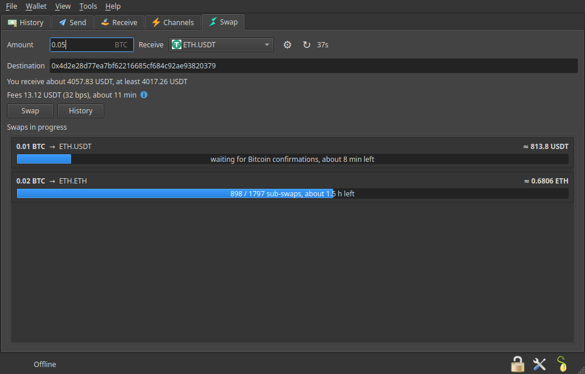

# THORChain Swap for Electrum

Swap bitcoin from your Electrum wallet into ETH, USDT, USDC, SOL, ATOM, LTC
and other assets through [THORChain](https://thorchain.org), without leaving
the wallet and without giving your coins to anyone first.

## Safety status

**Experimental. Use small amounts until you have done a few swaps you are
happy with.** Cross-chain swaps are irreversible: once your transaction is
confirmed, THORChain executes the swap and pays out to the address you
entered. There is no customer support that can send coins back.

## What it does

The plugin adds a **Swap** tab to each wallet window. You enter an amount of
bitcoin, pick the asset you want and paste the address that should receive
it. The plugin fetches a live quote from THORChain and shows what you will get,
the guaranteed minimum, the fees and the expected duration. Press **Swap**,
confirm the transaction in Electrum's usual dialog, sign it as you always do,
and the plugin sends it.

From then on THORChain takes over: it waits for the bitcoin confirmations,
performs the swap and sends the asset to your address. The tab shows every
swap in progress with a progress bar, and **History** lists all swaps made from
the wallet with their final result.

It is a one-way tool: bitcoin out of Electrum, other coins in to an address
you control elsewhere. It does not receive other coins into Electrum.

### Features

- Quotes update automatically while you type and refresh every minute.
- Price protection: the swap carries a minimum output; if the market moves
  against you by more than your tolerance, THORChain refunds the bitcoin
  (minus network fees) instead of swapping at a bad price.
- Streaming swaps for larger amounts (several sub-swaps over time for a better
  price), with the same settings as swap.thorchain.org.
- The vault address your bitcoin goes to is confirmed by a second, independently
  run THORChain node before the Swap button is enabled.
- Works with password-protected wallets, hardware wallets and multisig
  wallets that can complete a signature on this machine.
- Icons and asset names for everything THORChain currently trades.
- No accounts, no e-mail, no KYC, nothing to sign up for.

## Install

1. Download `thorchain_swap-<version>.zip` from the
   [releases page](../../releases).
2. In Electrum open **Tools → Plugins**, press **Add** and choose the zip.
3. Electrum shows the plugin details and its SHA-256 hash. Compare the hash
   with the one published in the release notes, then press **Install** and
   enable the plugin.
4. Open a wallet: the **Swap** tab appears after Receive.

Requires Electrum 4.7 or later (desktop version). Bitcoin mainnet only;
THORChain has no Bitcoin testnet, so the plugin stays disabled on testnet,
signet and regtest.

## Use

1. **Amount** – how much bitcoin to swap. THORChain has a minimum (a few
   thousand satoshis) and you need enough left for the mining fee.
2. **Receive** – the asset you want. The list contains every THORChain pool
   that is open for trading.
3. **Destination** – an address on the destination chain, for example an
   Ethereum address for ETH or USDT. Paste it without any `ethereum:` or
   `bitcoincash:` prefix. Double-check it: THORChain pays whatever address is
   in the memo, and a wrong address cannot be recovered.
4. Wait a second for the quote. It shows how much you receive, the guaranteed
   minimum, the fees and roughly how long the swap takes.
5. Press **Swap**. Electrum's transaction dialog opens: choose the mining fee
   (the plugin warns if it is below what THORChain recommends), confirm, and
   sign.

The swap then appears under **Swaps in progress** and moves through these
stages: waiting for the Bitcoin confirmation, counted by THORChain, swapping
(for streaming swaps you see the sub-swap counter), outbound being sent,
done. Finished swaps disappear from the box and stay in **History** with their
result: completed, refunded, or partially refunded.

### Settings (the gear button)

- **Price protection** – the maximum you accept to lose to price movement and
  price impact, from 0.1 % to 10 %. Default 1 %. If the quote's price impact
  alone is above this, the Swap button stays disabled and the tab tells you
  why; use a smaller amount, more sub-swaps, or a higher tolerance.
- **Number of sub-swaps** and **time between sub-swaps** – streaming swap
  settings. Leave them at *automatic* and *0 blocks* unless you know why you
  want otherwise; the explanations are in the dialog.

### Refunds

If a swap cannot be executed within your price protection, or THORChain
cannot pay out, THORChain sends the bitcoin back (minus network fees) to the
address the swap came from, which is one of your wallet addresses. Refunds
show up in Electrum's History like any incoming payment, and the swap is
marked *refunded* in the plugin's History.

## Fees

- **THORChain fees**: a liquidity fee (the price impact of your trade) and the
  outbound fee (gas on the destination chain). Both are included in the quote.
- **Plugin fee**: swaps worth $100 or more pay 0.1 % to the plugin developer
  through THORChain's affiliate mechanism. Swaps under $100 are free. The
  fee is listed next to the quote under the ⓘ icon, so you always see it
  before you confirm.
- **Bitcoin mining fee**: chosen by you in Electrum's confirmation dialog, as
  for any other transaction.

## Privacy

Quotes are requested from a public THORChain gateway (`gateway.liquify.com`
by default; another node can be set in the configuration). The request
contains the amount, the asset and the destination address, nothing about
your wallet. The vault address is then confirmed with a second node
(`public-thornode.nativeswap.io` by default), which only receives the vault's
public key, nothing about your swap. If Electrum is configured to use a
proxy or Tor, the plugin's requests go through it as well. Asset icons are
bundled with the plugin, so no icon servers are contacted. The plugin has no
telemetry.

## Limitations

- One direction only: BTC to other assets.
- Watch-only wallets and TrustedCoin two-factor wallets are not supported.
- Hardware wallets work, but the transaction has to be signed and sent while
  the quote is valid (15 minutes). Take your time typing, not signing.
- A swap cannot be cancelled once the bitcoin transaction is confirmed.
  THORChain executes it or refunds it.
- The vault address comes from the THORChain gateway and is cross-checked
  with a second, independent node. If the second node cannot be reached, the
  tab shows a warning and the swap is still allowed; if the two nodes
  disagree, the swap is refused. Both hosts can be changed in the
  configuration; point them at nodes you run yourself if that matters to you.

## Support

Questions and bug reports: open an issue in this repository. Please never
post seed words, private keys or wallet files; a transaction id is enough to
look into a swap.

## License

MIT, see [LICENSE](LICENSE). Asset logos are trademarks of their respective
projects, bundled only to identify the assets; see `icons/SOURCES.json` for
where each one came from.

Development notes are in [CONTRIBUTING.md](CONTRIBUTING.md).
